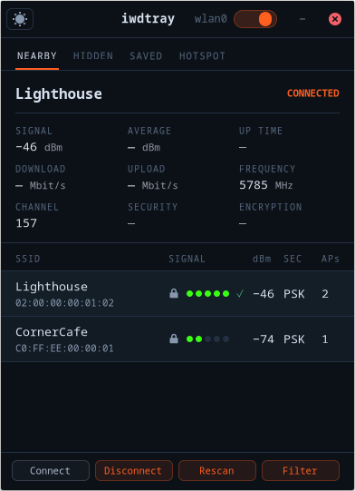
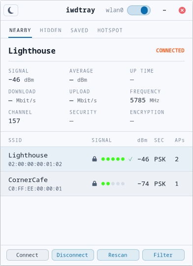

# iwdtray

A tray icon and GUI front-end for [iwd](https://iwd.wiki.kernel.org/) written in Rust.




- `iwdtray` starts at login and controls the tray icon.
- `iwdtray-gui` is the GUI front-end. It only runs when the tray icon is clicked.

There are two binaries to keep memory use low. `iwdtray` is the only one
running 99% of the time, using about 8 MB of memory. `iwdtray-gui` only runs
while you use the GUI, and frees its memory when you close it. This is Linux:
no unnecessary processes holding resources for long periods of time.

<br>

## Requirements

The tray for your desktop environment needs the following packages. Most of the
environments below already have the required package(s) installed. The chart is
added as a resource just in case you experience any issues.

| Desktop | Packages |
|:---|:---|
| KDE Plasma | `plasma-workspace` |
| Xfce | `xfce4-panel` |
| LXQt | `lxqt-panel` |
| Cinnamon | `cinnamon`, `xapp` |
| MATE | `mate-panel` |
| GNOME | `gnome-shell-extension-appindicator` |
| Budgie | `budgie-desktop` |
| COSMIC | `cosmic-applets` |
| sway | `sway` |
| Hyprland, river, other wlroots | `waybar` or `ironbar` |
| i3, Awesome, other XEmbed trays | `snixembed` |

iwd must be running: `sudo systemctl enable --now iwd`.

## Configuration

`/etc/iwdtray/iwdtray.conf` is the global configuration file and lists every
setting. `~/.config/iwdtray/iwdtray.conf` is the local configuration file,
which overrides any settings in `/etc/iwdtray/iwdtray.conf`.

## Permissions

Your user must be in the group that is allowed to control iwd, then log in
again:

| Distro | Group | Command |
|:---|:---|:---|
| Arch,&nbsp;Manjaro,&nbsp;EndeavourOS | `network`&nbsp;or&nbsp;`wheel` | `sudo usermod -aG network $USER` |
| Debian,&nbsp;Ubuntu,&nbsp;Mint | `netdev`&nbsp;or&nbsp;`sudo` | `sudo usermod -aG netdev $USER` |
| Fedora | `wheel`&nbsp;or&nbsp;`netdev` | `sudo usermod -aG wheel $USER` |
| Other | `netdev`&nbsp;or&nbsp;`wheel` | `sudo groupadd -f netdev && sudo usermod -aG netdev $USER` |

## Building

Needs Rust 1.92 or later, pkg-config and the GTK 4.12 (or later) development
files. The tests also need `dbus-daemon`.

```
cargo build --release
```

Install both binaries in the same directory. `scripts/install-user.sh` does
that for your user only, under `~/.local/lib/iwdtray`, and starts the tray at
login; `scripts/install-user.sh uninstall` removes it.

On Arch, run `makepkg -si` in `packaging/arch`. It builds the release tagged
on GitHub, not your checkout.

`scripts/build-packages.sh` builds a `.deb` for Ubuntu 24.04+ and Debian 13+,
and an `.rpm` for Fedora 44+, into `packaging/out`, from the last commit (not
uncommitted changes). It needs podman.

## Licence

GPL-3.0-or-later
